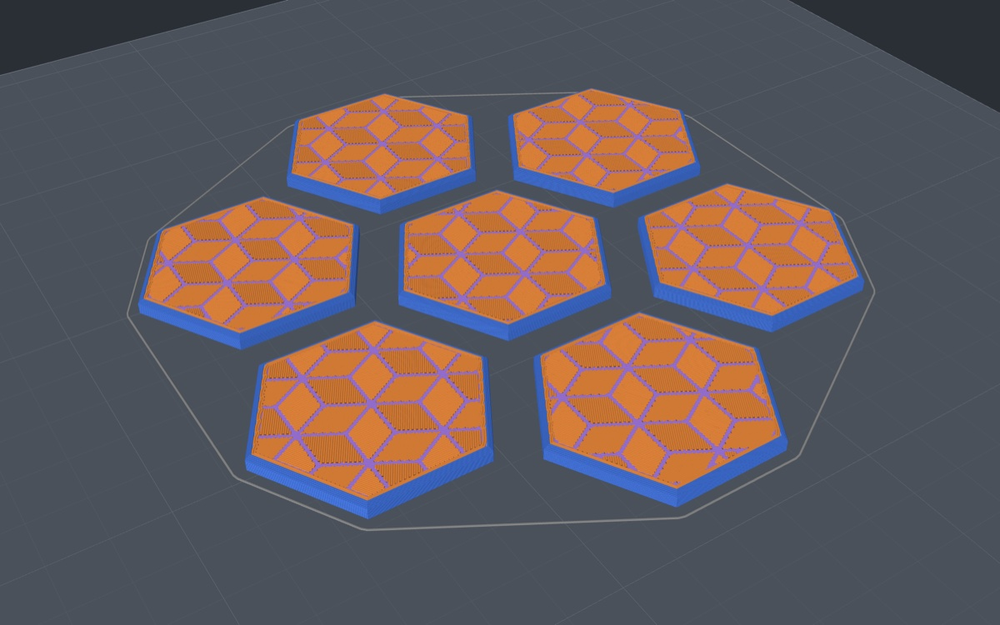
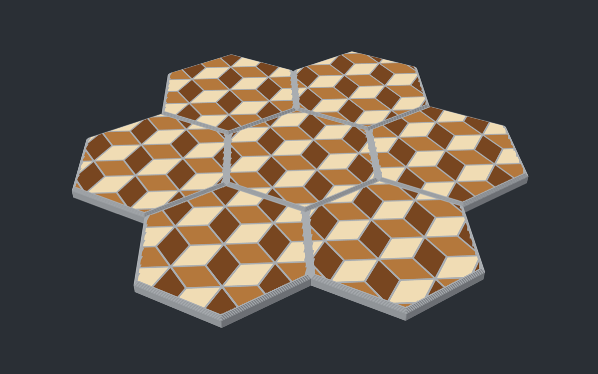
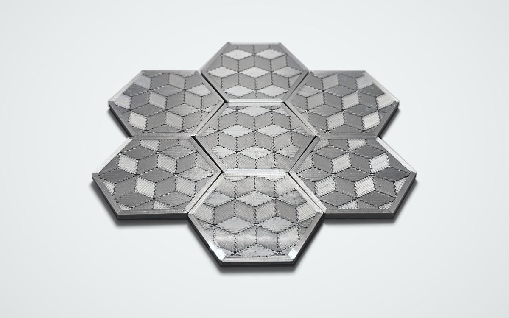
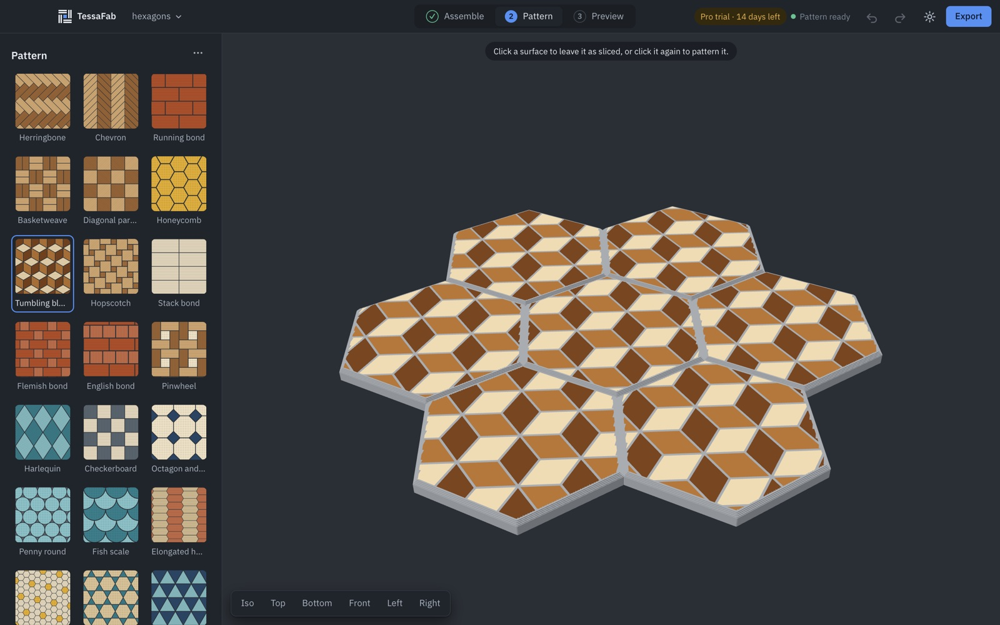
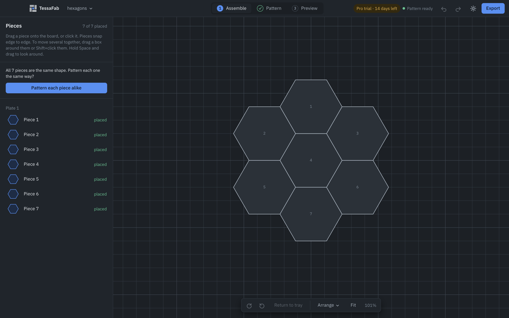
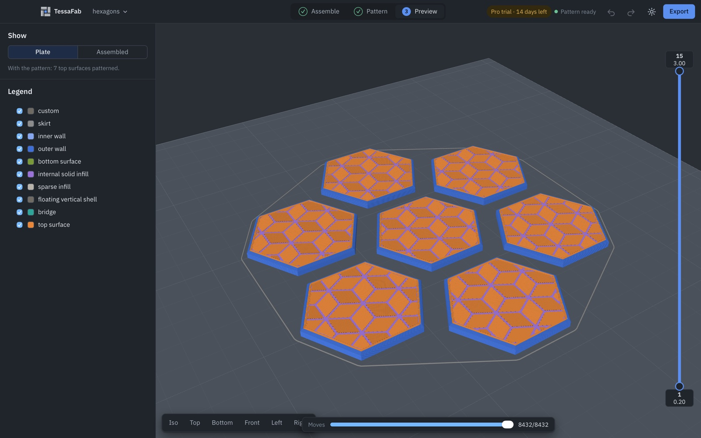

# TessaFab

Tile patterns for the things you make.

TessaFab lays decorative tile patterns onto the surfaces of the pieces you
make: herringbone, basketweave, hexagons, tumbling blocks and more than 50
others, or your own, drawn in any SVG editor. Each tile is made with its own
direction of line, so neighbouring tiles catch the light differently and the
pattern shows in the surface itself, in one material or in several colours.
A pattern can also run across many pieces that fit together, like a tiled
tabletop, a jigsaw or a set of coasters, and line up at the seams.

TessaFab starts with 3D printing. It reads plates sliced in Bambu Studio,
OrcaSlicer and PrusaSlicer, and rewrites the top surfaces of the pieces with
the pattern, so there's nothing to change in how you model or slice. More
ways of making things are to come.

## Patterns that line up across pieces

Make the pieces apart on one plate. Put them together and the pattern runs
straight across the joins.

<table>
  <tr>
    <td width="33%"></td>
    <td width="33%"></td>
    <td width="33%"><a href="docs/images/seams-made.jpg"></a></td>
  </tr>
  <tr>
    <td>The seven hexagons, spaced out on one plate</td>
    <td>The pattern, set up as they'll sit together</td>
    <td>The finished tiles in silver filament</td>
  </tr>
</table>

## The TessaFab app

A desktop app for macOS, Windows and Linux: put the pieces together, choose
and adjust a pattern, check it in 3D and export new G-code. Patterning one
piece is free. TessaFab Pro (with a 14-day trial) patterns whole assemblies
across many pieces and plates, turns images into patterns, and is licensed
for commercial use. The app isn't in this repository; it's a free download
from [tessafab.com](https://tessafab.com), and it runs the engine below.



**Pattern:** choose a pattern, adjust it, and see it on the pieces
in 3D.

<table>
  <tr>
    <td width="50%"></td>
    <td width="50%"></td>
  </tr>
  <tr>
    <td><b>Assemble:</b> fit the pieces together the way they'll be used. Edges snap flush.</td>
    <td><b>Preview:</b> the new G-code, layer by layer, before you export it.</td>
  </tr>
</table>

## This repository

The open source engine behind the app:

| Folder | What it is |
| --- | --- |
| [`crates/pattern`](https://github.com/tessafab/tessafab/tree/main/crates/pattern) | patterns and assemblies, independent of any file format |
| [`crates/engine`](https://github.com/tessafab/tessafab/tree/main/crates/engine) | the G-code engine |
| [`crates/server`](https://github.com/tessafab/tessafab/tree/main/crates/server) | the engine server (JSON-RPC over stdio), for front ends |
| [`crates/cli`](https://github.com/tessafab/tessafab/tree/main/crates/cli) | the `tessafab` command line and slicer hook |
| [`crates/dev`](https://github.com/tessafab/tessafab/tree/main/crates/dev) | a developer tool |
| [`patterns`](https://github.com/tessafab/tessafab/tree/main/patterns) | the provided patterns, as SVG |
| [`examples`](https://github.com/tessafab/tessafab/tree/main/examples) | example models, sliced, with ready projects |
| [`fixtures`](https://github.com/tessafab/tessafab/tree/main/fixtures) | sliced plates the tests use |
| [`portal`](https://github.com/tessafab/tessafab/tree/main/portal) | a basic web front end (planned) |

How the engine is put together:
[docs/engine.md](https://github.com/tessafab/tessafab/blob/main/docs/engine.md).

## The command line

```sh
cargo build --release
./target/release/tessafab --project coaster.tessafab.json plate_1.gcode
```

`tessafab --project FILE [-o OUT] [-q] GCODE` rewrites one sliced plate
(`.gcode` or `.bgcode`) with a saved project's pattern, in place unless `-o`
is given. A project is saved by the TessaFab app; its format is described at
the top of
[`crates/engine/src/project.rs`](https://github.com/tessafab/tessafab/blob/main/crates/engine/src/project.rs).

Because it rewrites the file in place, it can be a slicer's post-processing
script, so every slice gets the pattern. In Bambu Studio or OrcaSlicer, it
goes under *Process → Others → Post-processing scripts*; in PrusaSlicer, under
*Print Settings → Output options*:

```
/path/to/tessafab --project /path/to/coaster.tessafab.json -q
```

The slicer adds the output file. If anything goes wrong, the G-code is left
unchanged and the exit status says so. Built from this source, the engine
patterns one piece on one plate.

## Building and testing

Rust stable via [rustup](https://rustup.rs):

```sh
cargo build --release
cargo test
cargo clippy --all-targets -- -D warnings
cargo fmt --check
```

## Licence

TessaFab is source-available, not open source in the OSI sense:

- **Code:** [PolyForm Noncommercial 1.0.0](https://github.com/tessafab/tessafab/blob/main/LICENSE.md).
  Read it, build it, change it and share it for any non-commercial purpose.
- **Patterns and examples:** [CC BY-NC 4.0](https://github.com/tessafab/tessafab/blob/main/patterns/LICENSE.md).
- **Commercial use** needs TessaFab Pro. That includes selling pieces,
  G-code or pattern packs made with TessaFab, and paid work.

The TessaFab name and logo are trademarks; see
[TRADEMARKS.md](https://github.com/tessafab/tessafab/blob/main/TRADEMARKS.md).

## Contributing

Bug reports, pattern ideas and pull requests are welcome; see
[CONTRIBUTING.md](https://github.com/tessafab/tessafab/blob/main/CONTRIBUTING.md).
Contributions need a contributor licence agreement, signed on your first pull
request.
